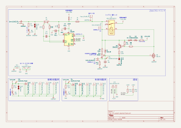
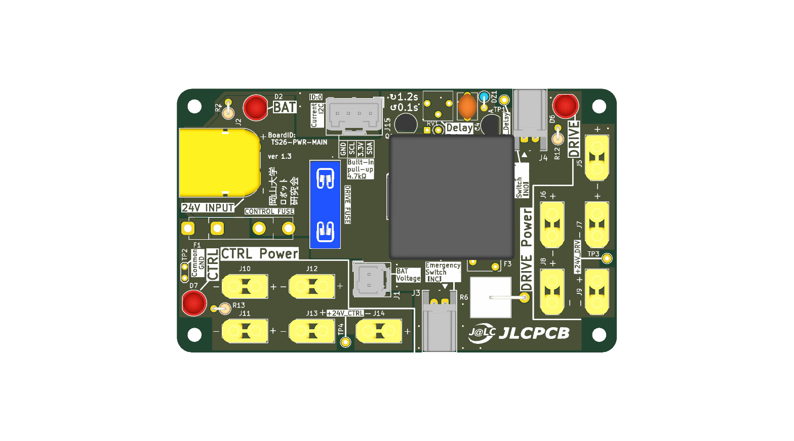
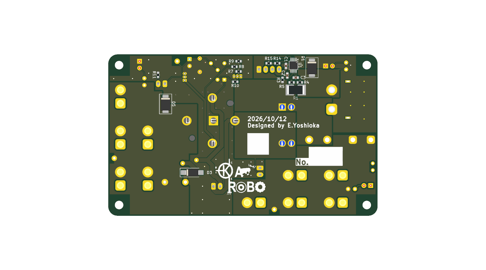
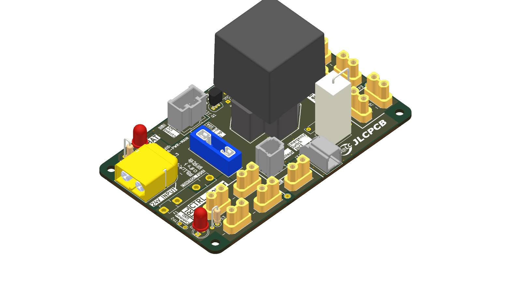
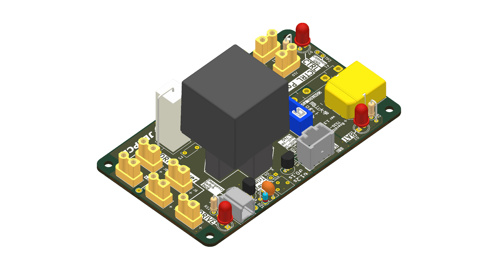

# 【ver 1.3】24v_power_board

この基板は以下のような機能を持っています．
- INA226を用いた電流・電圧の監視
- 非常停止や調整可能なプリチャージ
- 制御と駆動で分けられたヒューズ
- 制御用GNDと駆動用GNDの1点接続
- 24V電源の分配
## 回路図 (Schematic)

---

## 外観 (3D Rendering)

| 表面 (Top)                | 裏面 (Bottom)                   |
|:-----------------------:|:-----------------------------:|
|  |  |

| 斜視 (Isometric)                | 反対斜視 (Reverse Isometric)         |
|:-----------------------------:|:--------------------------------:|
|  |  |

---

## コネクタ・ピンアサイン

### J1: 電圧モニタ
電圧モニタを接続するためのコネクタ．ヒューズは駆動用の30Aのみであるため，ショートに注意．

| ピン | 種類 | 信号名 | 説明      |
| ------ | ------ | ------- | ----------- |
| 1      | 電源     | GNDPWR  |             |
| 2      | 信号出力   | 24V     | 電圧モニタ用の電圧出力 |
### J2: 電源入力
電源入力用のコネクタ．6Sリポバッテリーや24Vに設定した安定化電源に接続することを想定．

| ピン  | 種類   | 信号名    | 説明  |
| --- | ---- | ------ | --- |
| 1   | 電源入力 | GNDPWR |     |
| 2   | 電源入力 | 24V    |     |
### J3, J4: 非常停止スイッチ
非常停止スイッチを接続するコネクタ．2つコネクタがあるが，1a1b接点の1つのスイッチを接続する想定．

| J3  | J4  | 想定される状態                                  | 動作                                          |
| --- | --- | ---------------------------------------- | ------------------------------------------- |
| 開放  | 開放  | スイッチが接続されていない場合                          | 駆動用電源を遮断                                    |
| 短絡  | 開放  | 非常停止スイッチが押されていない場合                       | プリチャージ後，駆動用電源を接続                            |
| 開放  | 短絡  | 非常停止スイッチが押された場合                          | 駆動用電源を遮断                                    |
| 短絡  | 短絡  | 何らかの原因によりa接点(NO)が溶着した状態で非常停止スイッチが解除された場合 | プリチャージ抵抗を介して電流が流れるが，数秒後にポリヒューズによって駆動用電源が遮断． |
### J5~J9: 駆動用電源
モータなど大電流を要求する物を接続する端子．

| ピン  | 種類   | 信号名    | 説明  |
| --- | ---- | ------ | --- |
| 1   | 電源出力 | GNDPWR |     |
| 2   | 電源出力 | 24V    |     |
### J10~J14: 制御用電源
マイコンなど小電力を要求する物を接続する端子．

| ピン  | 種類   | 信号名 | 説明  |
| --- | ---- | --- | --- |
| 1   | 電源出力 | GND |     |
| 2   | 電源出力 | 24V |     |
### J15: 電圧・電流センサ
外部からINA226と通信するための端子．規格はI2C．

| ピン  | 種類    | 信号名  | 説明                  |
| --- | ----- | ---- | ------------------- |
| 1   | 電源    | GND  |                     |
| 2   | 信号入出力 | SCL  |                     |
| 3   | 電源入力  | 3.3V | INA226を動作させるための電源入力 |
| 4   | 信号入出力 | SDA  |                     |

---
## 機能の紹介
### 電圧・電流のモニタ
本基板では駆動用電源や制御用電源を含めた最上流にINA226と1mΩのシャント抵抗を接続している．これとI2Cで通信することにより，電圧や電流を読み取ることができる．

| 項目      | パラメータ             | 補足                     |
| ------- | ----------------- | ---------------------- |
| シャント抵抗  | 1mΩ               |                        |
| バス電圧端子  | シャント抵抗下流に接続       | 過電圧防止のためにRCフィルタも接続している |
| アドレス    | 0x40 (0b01000000) |                        |
| プルアップ抵抗 | 4.7kΩで実装済み        | SDA，SCLの両方に実装している      |
### インジケータLED
#### D2: バッテリーLED
| LED | 状態                |
| --- | ----------------- |
| 点灯  | 電源入力端子に電源が接続されている |
| 消灯  | 電源が接続されていない       |
#### D6: 駆動用電源LED
| LED | 状態             |
| --- | -------------- |
| 点灯  | 駆動用電源が供給されている  |
| 消灯  | 駆動用電源が供給されていない |
#### D7: 制御用電源LED
| LED | 状態             |
| --- | -------------- |
| 点灯  | 制御用電源が供給されている  |
| 消灯  | 制御用電源が供給されていない |
### プリチャージ時間の調整
可変抵抗RV1を調整することにより，プリチャージから通常状態へ移行する時間を約0.1秒~約1.2秒の範囲で調整することができる．
### 非常停止
J3,J4に正しく非常停止スイッチを接続することにより，非常停止が行われるようになる．なお注意点として，駆動用電源は遮断されるが，制御用電源は遮断されない．
また，非常停止スイッチを解除すると駆動用電源への供給も自動的に再開される．これは非常停止の動作として適していないが，回路の単純化のために許容している．

| 状態       | 駆動用電源        | 制御用電源 |
| -------- | ------------ | ----- |
| OFF → ON | 供給→遮断        | 供給    |
| ON → OFF | 遮断→プリチャージ→供給 | 供給    |

---
## 安全
### 禁止事項
#### 電源の逆接続
本基板には逆接続保護回路が無い．J2に対し，電源の+-を逆に接続すると基板上の複数の部品が破損・発火する可能性がある．
#### 外部での制御用GNDと駆動用GND (GNDPWR)の接続
本基板では駆動用GNDと制御用GNDを分離し，ネットタイ1点のみで接続している．外部の配線や別基板においてこの両GNDを接続してしまうと，モータ等を流れた大きなリターン電流が信号用GNDを通り，基板の焼損や通信以上を発生させる可能性がある．
#### プリチャージ完了前の大電流負荷の駆動
電源投入直後から0.1~1.2秒間のプリチャージ期間にモータ等を始動すると，プリチャージ抵抗に大電流が流れ続け，過熱・焼損・ポリヒューズによる電源遮断が発生する可能性がある．
### 注意事項
#### 負荷容量に対して不適切なプリチャージ時間の設定
プリチャージ時間が負荷容量に対して十分でないと，リレー側に大きな突入電流が流れ，接点溶着を起こす可能性がある．プリチャージ時間を調整する場合は駆動側電源の電圧をオシロスコープなどを用いて確認し，プリチャージが完了するのに十分な時間であることを確認することを推奨する．

---
## 更新履歴
| 対象基板バージョン | 日付         | 変更内容      |
| --------- | ---------- | --------- |
| 1.3       | 2026/10/12 | ドキュメントを作成 |

---
## 関連成果物・リンク

- **回路図 (PDF)**: [`docs/24v_power_board_schematic.pdf`](docs/24v_power_board_schematic.pdf)
- **回路図 (SVG)**: [`docs/24v_power_board_schematic.svg`](docs/24v_power_board_schematic.svg)
- **部品表 (BOM)**: [`docs/24v_power_board_bom.csv`](docs/24v_power_board_bom.csv)
- **3D CADモデル (STEP)**: [`24v_power_board.step`](24v_power_board.step)
- **製造データ (Gerber)**: 発注用ガーバーZIPは [GitHub Releases](../../releases) を参照してください。
