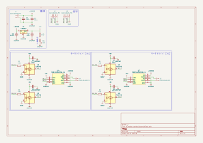
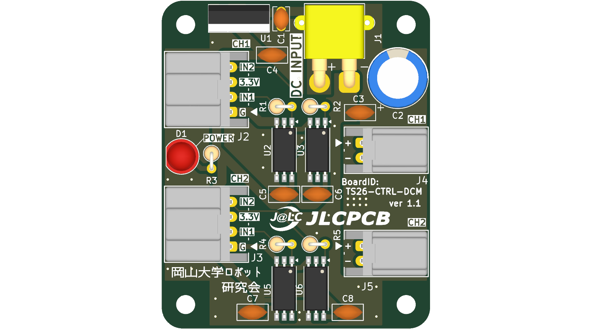
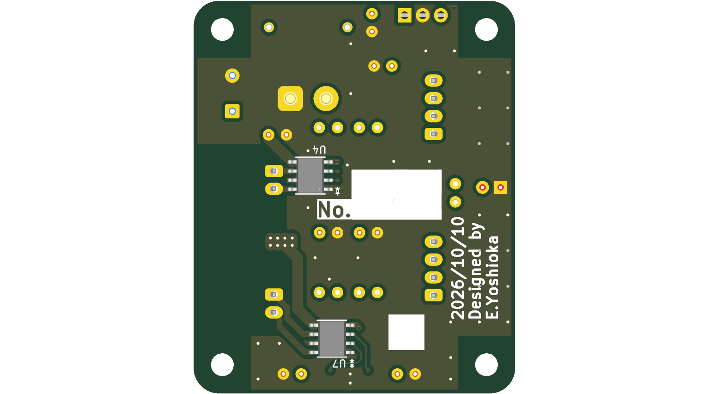
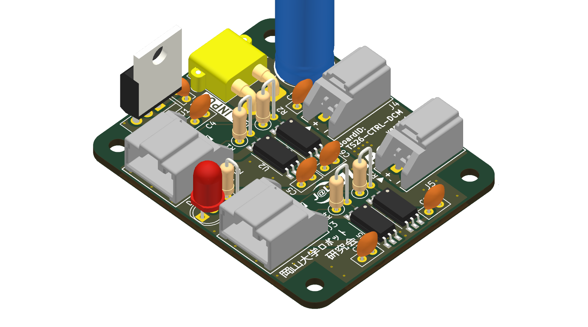
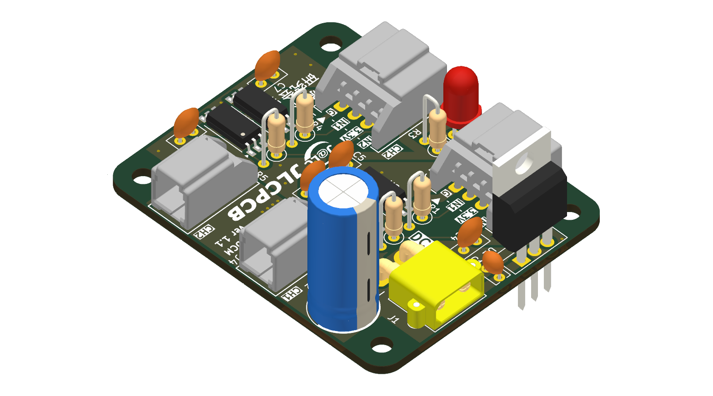

# 【ver 1.1】DCmotor_control_board
この基板は以下のような機能を持っています．
- 2つのDCモータの正転・逆転・ブレーキをPWM制御
- フォトカプラにより制御系と駆動系を絶縁

## 回路図 (Schematic)

---

## 外観 (3D Rendering)

|        表面 (Top)         |          裏面 (Bottom)          |
| :---------------------: | :---------------------------: |
|  |  |

| 斜視 (Isometric) | 反対斜視 (Reverse Isometric) |
| :---: | :---: |
|  |  |

---

## 機能の紹介
### PWMモータ制御
IN1~4にはPWM信号を入力することができ，デューティー比を変更することにより，加減速を行うことができる．
なお，PWM周波数は20kHz~100kHzの範囲で運用することを推奨し，1kHz以下や400kHz以上で運用することはできない．これは主にモータドライバの限界と人の可聴域に起因する．
### 絶縁
GND1，GND2，GNDPWRはそれぞれ絶縁されている．そのため，もし，同一マイコンでCH1とCH2の両方を制御したい場合であっても，GND1とGND2の両方をマイコンのGNDと接続しなければならない．
### インジケータLED
#### D1: モータ電源LED
| LED | 状態                    |
| --- | --------------------- |
| 点灯  | 電源入力端子(J1)に電源が接続されている |
| 消灯  | 電源が接続されていない    |       
このLEDはモータ電源に接続されているのではなく，L7805によって作られる5Vによって駆動されていることに注意しなければならない．例えばL7805が壊れた場合，モータ電源を接続してもLEDが光らないことがある．

---

## コネクタ・ピンアサイン

### J1: 電源入力
電源入力用のコネクタ．

| ピン  | 種類   | 信号名    | 説明                       |
| --- | ---- | ------ | ------------------------ |
| 1   | 電源入力 | GNDPWR |                          |
| 2   | 電源入力 | +MOTOR | 8~24Vを推奨．35V以下でなければいけない． |

### J2: 信号入力(CH1)
CH1モータ用の信号入力端子．

| ピン  | 種類   | 信号名  | 説明                   |
| --- | ---- | ---- | -------------------- |
| 1   | 電源   | GND1 |                      |
| 2   | 信号入力 | IN1  | 3.3Vロジック．順電流は約3.7mA． |
| 3   | 未接続  | NC   |                      |
| 4   | 信号入力 | IN2  | 3.3Vロジック．順電流は約3.7mA． |

| IN1 | IN2 | モータ(CH1)の動作 |
| --- | --- | ----------- |
| L   | L   | ストップ        |
| H   | L   | 正転          |
| L   | H   | 逆転          |
| H   | H   | ブレーキ        |

### J3: 信号入力(CH2)
CH2モータ用の信号入力端子．

| ピン  | 種類   | 信号名  | 説明                   |
| --- | ---- | ---- | -------------------- |
| 1   | 電源   | GND2 |                      |
| 2   | 信号入力 | IN3  | 3.3Vロジック．順電流は約3.7mA． |
| 3   | 未接続  | NC   |                      |
| 4   | 信号入力 | IN4  | 3.3Vロジック．順電流は約3.7mA． |

| IN3 | IN4 | モータ(CH2)の動作 |
| --- | --- | ----------- |
| L   | L   | ストップ        |
| H   | L   | 正転          |
| L   | H   | 逆転          |
| H   | H   | ブレーキ        |

### J4: モータ(CH1)
CH1のモータを接続する端子．モータドライバの発熱なども考慮し，出力電流は2.45A以下が推奨される．出力電流が3.5Aを超えてはならない．

| ピン  | 種類   | 信号名       | 説明         |
| --- | ---- | --------- | ---------- |
| 1   | 電源出力 | OUT1(CH1) | モータの+端子を接続 |
| 2   | 電源出力 | OUT2(CH1) | モータの-端子を接続 |

| IN1 | IN2 | OUT1 | OUT2 |
| --- | --- | ---- | ---- |
| L   | L   | Hi-Z | Hi-Z |
| H   | L   | H    | L    |
| L   | H   | L    | H    |
| H   | H   | L    | L    |

### J5: モータ(CH2)
CH2のモータを接続する端子．モータドライバの発熱なども考慮し，出力電流は2.45A以下が推奨される．出力電流が3.5Aを超えてはならない．

| ピン  | 種類   | 信号名       | 説明         |
| --- | ---- | --------- | ---------- |
| 1   | 電源出力 | OUT1(CH2) | モータの+端子を接続 |
| 2   | 電源出力 | OUT2(CH2) | モータの-端子を接続 |

| IN3 | IN4 | OUT1 | OUT2 |
| --- | --- | ---- | ---- |
| L   | L   | Hi-Z | Hi-Z |
| H   | L   | H    | L    |
| L   | H   | L    | H    |
| H   | H   | L    | L    |

---

## 安全・禁止事項・注意事項

### 禁止事項
#### 電源の逆接続
本基板には逆接続保護回路が無い．J1に対し，電源の+-を逆に接続すると基板上の複数の部品が破損・発火する可能性がある．

### 注意事項
#### 入力電圧が高い場合のレギュレータ(U1)の発熱
モータ電源の電圧が24Vなど高い場合，L7805CVの入出力電圧差によって発熱が大きくなる．連続稼働時はレギュレータの発熱が許容範囲内か確認することを推奨する．

---

## 更新履歴
| 対象基板バージョン | 日付    | 変更内容      |
| --------- | ----- | --------- |
| 1.1       | 10/12 | ドキュメントを作成 |

---

## 関連成果物・リンク

- **回路図 (PDF)**: [`docs/DCmotor_control_board_schematic.pdf`](docs/DCmotor_control_board_schematic.pdf)
- **回路図 (SVG)**: [`docs/DCmotor_control_board_schematic.svg`](docs/DCmotor_control_board_schematic.svg)
- **部品表 (BOM)**: [`docs/DCmotor_control_board_bom.csv`](docs/DCmotor_control_board_bom.csv)
- **3D CADモデル (STEP)**: [`DCmotor_control_board.step`](DCmotor_control_board.step)
- **製造データ (Gerber)**: 発注用ガーバーZIPは [GitHub Releases](../../releases) を参照してください。
