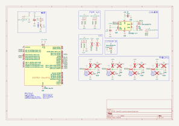
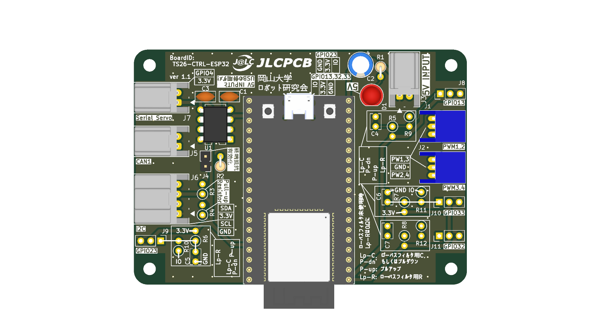
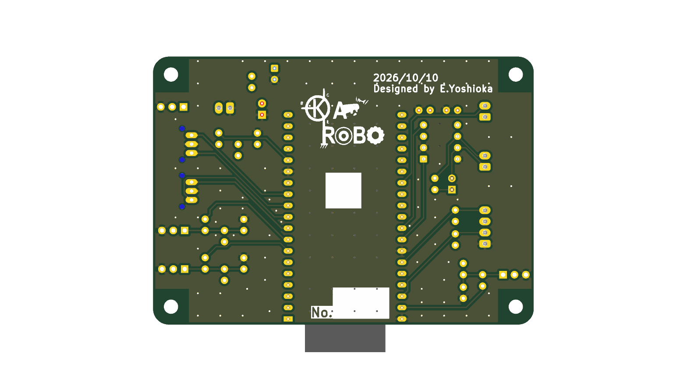
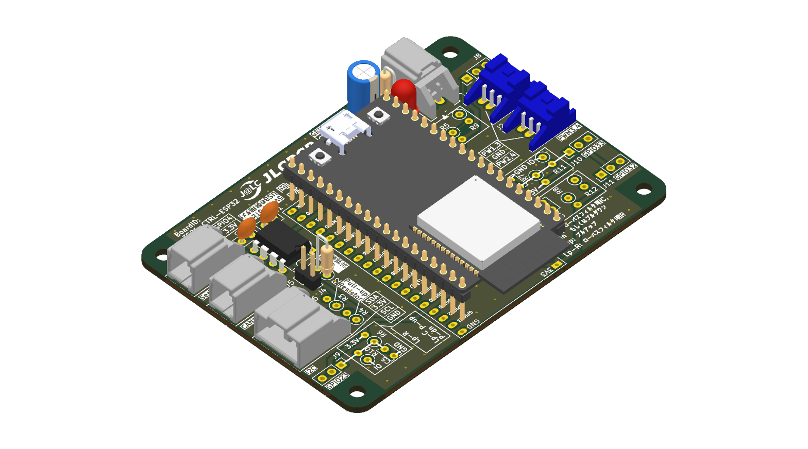
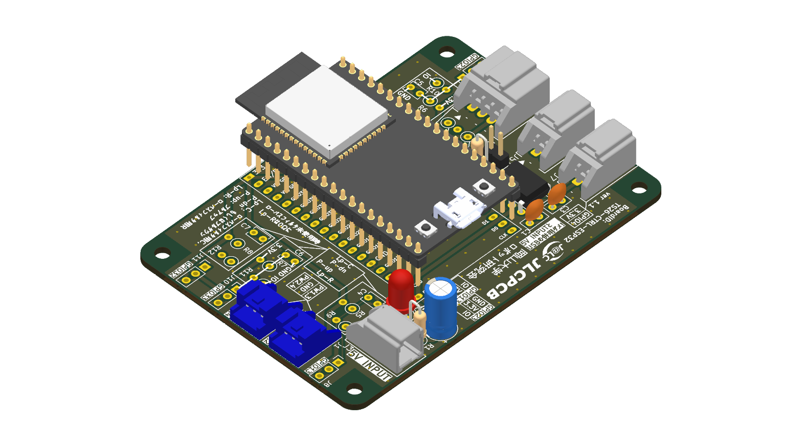
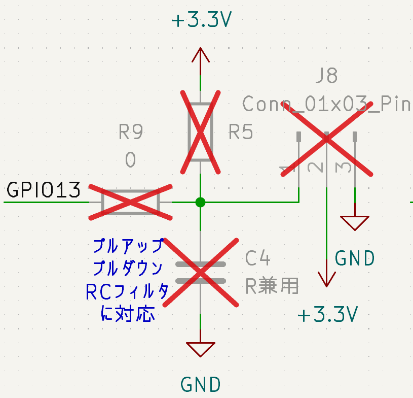

# 【ver 1.1】ESP32-DevKitC_control_board

## 回路図 (Schematic)

---

## 外観 (3D Rendering)

|        表面 (Top)         |          裏面 (Bottom)          |
| :---------------------: | :---------------------------: |
|  |  |

| 斜視 (Isometric) | 反対斜視 (Reverse Isometric) |
| :---: | :---: |
|  |  |

---

## 機能の紹介
### ペリフェラル
#### PWM
PWMはJ1に2ch，J2に2chの合計4ch引き出されている．

| マイコン側  | 信号名  |
| ------ | ---- |
| GPIO14 | PWM1 |
| GPIO27 | PWM2 |
| GPIO25 | PWM3 |
| GPIO26 | PWM4 |
#### I2C
I2CはJ6に1ch引き出されている．

| マイコン側  | 信号名     |
| ------ | ------- |
| GPIO21 | I2C_SDA |
| GPIO22 | I2C_SCL |

なお，R3とR4を実装することにより，SDAとSCLを3.3Vでプルアップすることができる．
#### CAN
CANはJ5に1ch引き出されている．

| マイコン側  | 信号名    |
| ------ | ------ |
| GPIO18 | CAN_RX |
| GPIO19 | CAN_TX |
#### シリアル
シリアルサーボへ接続することを想定し，J7に1GPIOのみ1ch引き出されている．なお，プルアップはされていない．

| マイコン側 | 信号名   |
| ----- | ----- |
| 3.3V  | 3.3V  |
| GPIO4 | GPIO4 |
#### 予備GPIO
汎用用途にGPIO13，GPIO23，GPIO32，GPIO33が引き出されている．
各GPIOには以下のような回路が接続されており，以下の例ではR5，R9，C4に部品を実装することで，信号線のプルアップ，プルダウン，RCフィルタなどの処理を施すことができる．

なお，基板上ではリファレンスに加えて以下のように記載されている．

| 上図での例 | 基板上での表示      |
| ----- | ------------ |
| R5    | P-up         |
| R9    | Lp-R         |
| C4    | Lp-C P-dn |

施したい処理に応じた部品の実装の対応は以下のようになっている．
##### 通常時
| 対象           | 実装     |
| ------------ | ------ |
| P-up         | 未実装    |
| Lp-R         | 0Ω(短絡) |
| Lp-C P-dn | 未実装    |
##### プルアップ
| 対象           | 実装      |
| ------------ | ------- |
| P-up         | プルアップ抵抗 |
| Lp-R         | 0Ω(短絡)  |
| Lp-C P-dn | 未実装     |
##### プルダウン
| 対象           | 実装      |
| ------------ | ------- |
| P-up         | 未実装     |
| Lp-R         | 0Ω(短絡)  |
| Lp-C P-dn | プルダウン抵抗 |
##### RCフィルタ(ローパスフィルタ)
| 対象           | 実装    |
| ------------ | ----- |
| P-up         | 未実装   |
| Lp-R         | 抵抗    |
| Lp-C P-dn | コンデンサ |
### インジケータLED
#### D1: 電源LED
| LED | 状態                |
| --- | ----------------- |
| 点灯  | 電源入力端子に電源が接続されている |
| 消灯  | 電源が接続されていない       |

---

## コネクタ・ピンアサイン

### J1: 

| ピン  | 種類  | 信号名 | 説明  |
| --- | --- | --- | --- |
|     |     |     |     |

---

## 安全・禁止事項・注意事項

### 禁止事項

### 注意事項

---

## 更新履歴
| 対象基板バージョン | 日付  | 変更内容 |
| --------- | --- | ---- |
|           |     |      |

---

## 関連成果物・リンク

- **回路図 (PDF)**: [`docs/ESP32-DevKitC_control_board_schematic.pdf`](docs/ESP32-DevKitC_control_board_schematic.pdf)
- **回路図 (SVG)**: [`docs/ESP32-DevKitC_control_board_schematic.svg`](docs/ESP32-DevKitC_control_board_schematic.svg)
- **部品表 (BOM)**: [`docs/ESP32-DevKitC_control_board_bom.csv`](docs/ESP32-DevKitC_control_board_bom.csv)
- **3D CADモデル (STEP)**: [`ESP32-DevKitC_control_board.step`](ESP32-DevKitC_control_board.step)
- **製造データ (Gerber)**: 発注用ガーバーZIPは [GitHub Releases](../../releases) を参照してください。
