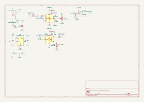
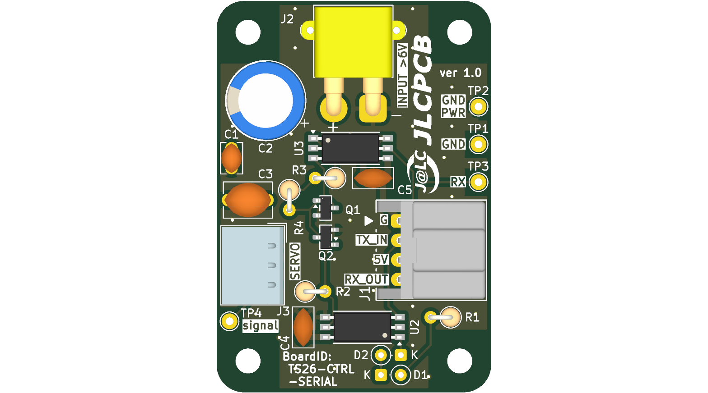
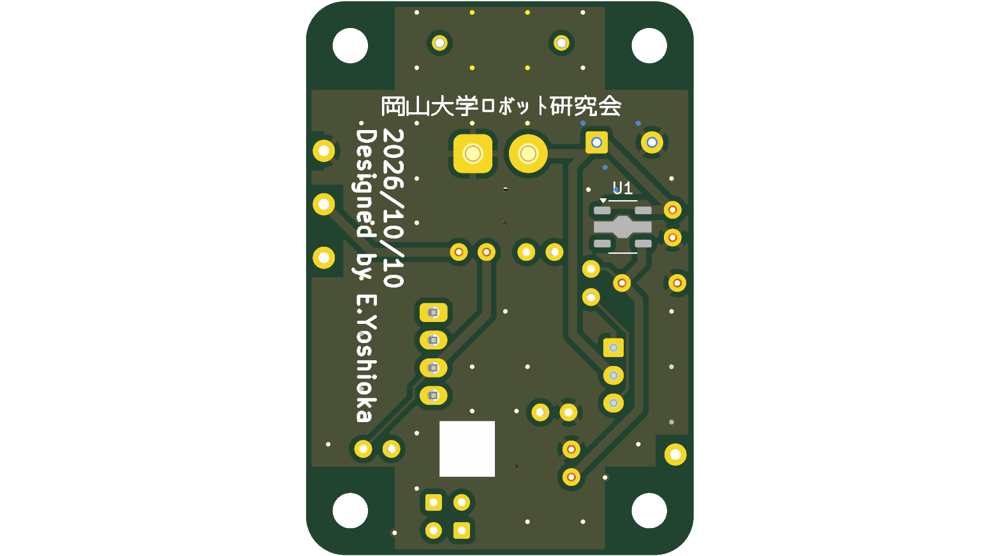
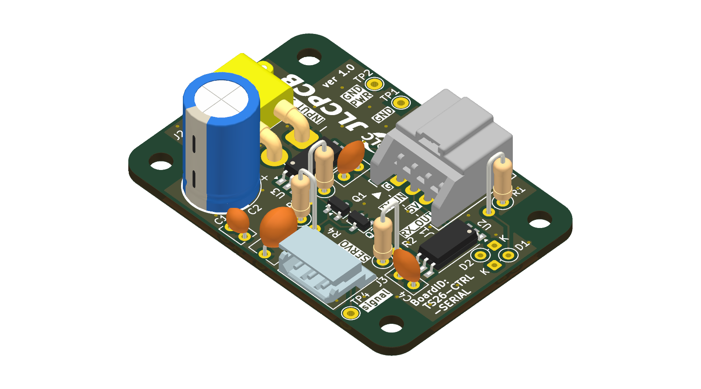
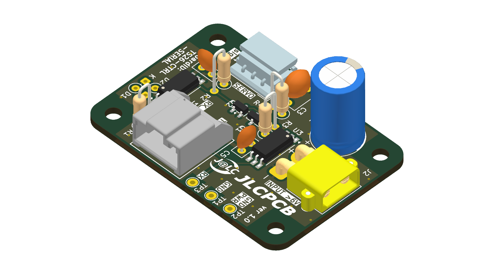

# 【ver 】serial_servo_control_board

## 回路図 (Schematic)

---

## 外観 (3D Rendering)

| 表面 (Top) | 裏面 (Bottom) |
| :---: | :---: |
|  |  |

| 斜視 (Isometric) | 反対斜視 (Reverse Isometric) |
| :---: | :---: |
|  |  |

---

## 機能の紹介

---

## コネクタ・ピンアサイン

### J1: 

| ピン | 種類 | 信号名 | 説明 |
| --- | --- | --- | --- |
| | | | |

---

## 安全・禁止事項・注意事項

### 禁止事項

### 注意事項

---

## 更新履歴
| 対象基板バージョン | 日付 | 変更内容 |
| --- | --- | --- |
| | | |

---

## 関連成果物・リンク

- **回路図 (PDF)**: [`docs/serial_servo_control_board_schematic.pdf`](docs/serial_servo_control_board_schematic.pdf)
- **回路図 (SVG)**: [`docs/serial_servo_control_board_schematic.svg`](docs/serial_servo_control_board_schematic.svg)
- **部品表 (BOM)**: [`docs/serial_servo_control_board_bom.csv`](docs/serial_servo_control_board_bom.csv)
- **3D CADモデル (STEP)**: [`serial_servo_control_board.step`](serial_servo_control_board.step)
- **製造データ (Gerber)**: 発注用ガーバーZIPは [GitHub Releases](../../releases) を参照してください。
